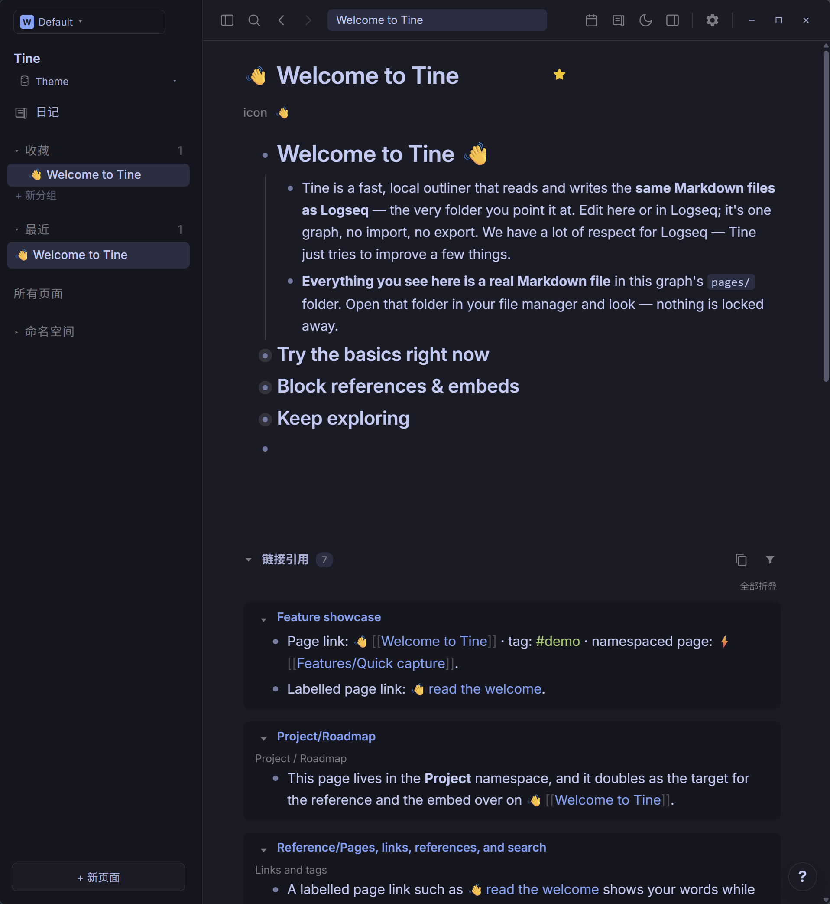
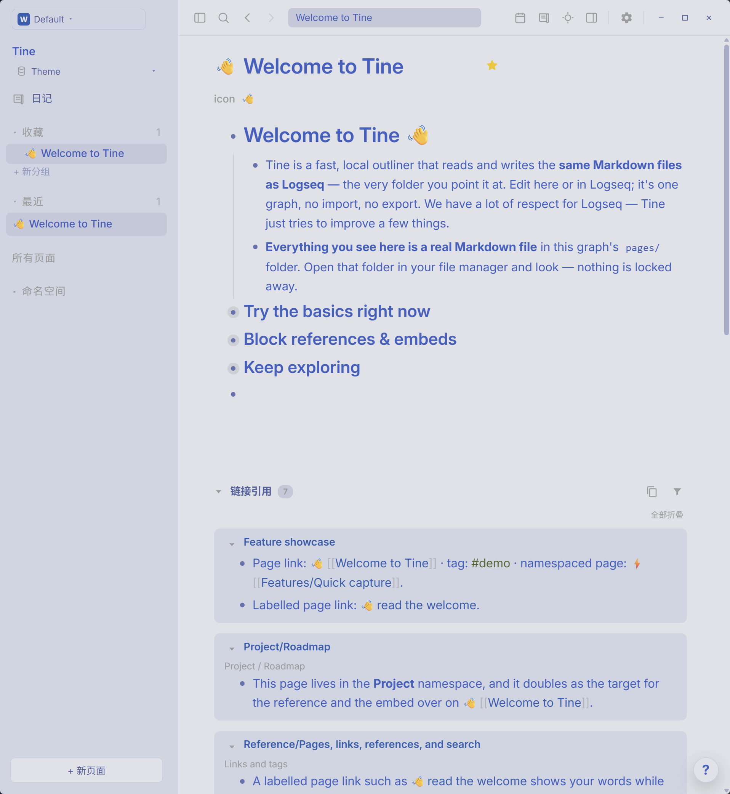

# Tokyo Night · Prism

**蓝色灯火漫过白昼，靛青为城市披上夜衣。让末班车，载着思绪慢慢归去。**

[English](README.md) · [下载 theme.json](https://github.com/EllisMorrow/tine-theme-tokyo-night-prism/releases/latest/download/theme.json)

Tokyo Night Day 与 Night 相逢于同一款 Tine 主题：日间是清冷蓝灰，夜里沉入靛青城色，以明亮蓝色链接和沉静绿意作点缀。

### 深色模式

### 浅色模式

*用户测试后提供的 Windows 实机截图，两套配色均实际包含在同一个主题包中。*

## 安装

1. 下载 [theme.json](https://github.com/EllisMorrow/tine-theme-tokyo-night-prism/releases/latest/download/theme.json)。
2. 在 Tine 打开 **设置 → 外观 → 主题包 → 选择 theme.json**，选择下载的文件。
3. 点击 **使用颜色**，选择 **浅色、深色或跟随系统**。

需要主题 API **0.2** 支持。原有 `logseq/custom.css` 和设备强调色可能影响效果；主题只负责 API 支持的颜色，不包含额外字体、布局或任务标记样式。

## 配色

| 角色 | 浅色 | 深色 |
| --- | --- | --- |
| 主背景 | `#E1E2E7` | `#1A1B26` |
| 侧栏 | `#D0D5E3` | `#16161E` |
| 正文 | `#3760BF` | `#C0CAF5` |
| 标题 | `#3760BF` | `#C0CAF5` |
| 强调色 | `#2E7DE9` | `#7AA2F7` |
| 链接 | `#245EB0` | `#7AA2F7` |
| 标签 | `#4D682F` | `#9ECE6A` |
| 高亮底色 | `#EEE1C8` | `#41425A` |

## 验证情况

通过官方主题格式检查；浏览器样例检查了两套完整变量、模式切换及指定颜色组合。用户提供了上方 Windows 明暗实机截图，展示公开欢迎页面上的标题、正文、层级、链接、标签、行内代码和引用区域。高亮、选中操作、设置状态和其它平台未由这些截图覆盖，不据此宣称全部路径均已验证。

## 来源与边界

基于 [Tokyo Night Day / Night](https://github.com/folke/tokyonight.nvim)，固定版本 `545d72cde6400835d895160ecb5853874fd5156d`，采用 Apache-2.0 许可并保留 [原始声明](LICENSE)。深色模式采用 Tokyo Night Night，浅色模式采用上游官方 Day。Codex 原参考为深色；Day 是上游原生浅色变体，不声称为 Codex 原生浅色预设。上游项目采用 Apache-2.0，本地包保留其许可证与来源说明。

独立社区适配由 EllisMorrow 完成，使用 AI 辅助开发。不分发 Codex 程序代码、标志或附带资源，不代表相关项目或 OpenAI 的官方产品，也不承诺与 Codex 像素级一致。具体映射和验证边界见 [适配说明](docs/adaptation.md)。

顶部徽标统计 GitHub Release 附件累计下载量，不代表安装人数。可在本仓库反馈问题，附版本、系统、模式及不包含私人内容的截图。

